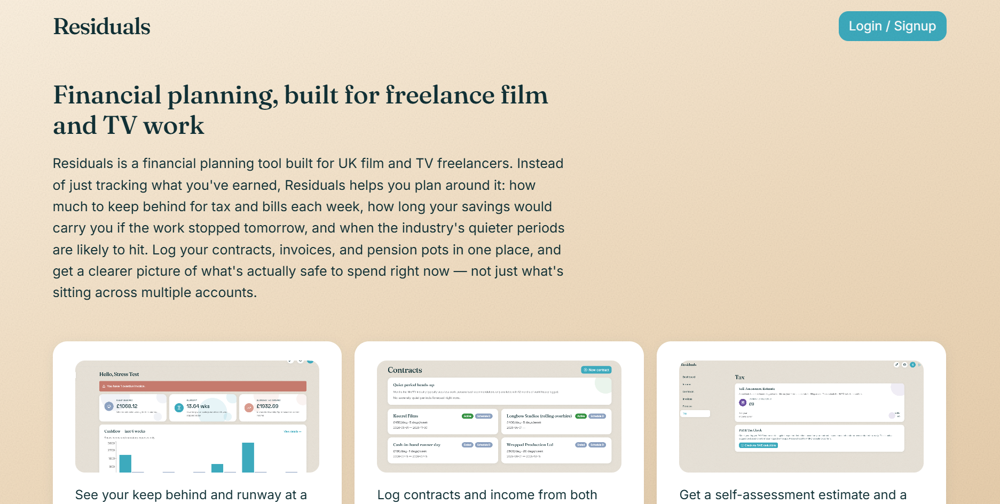
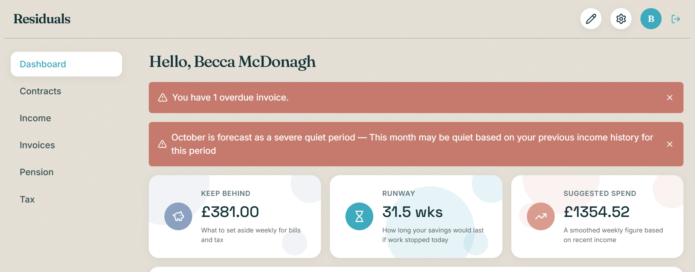
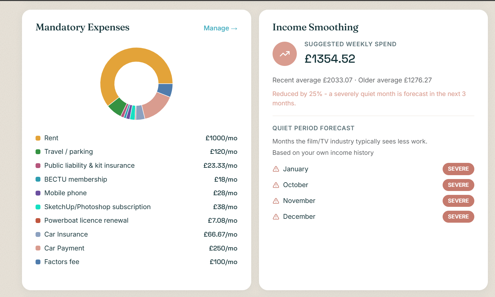
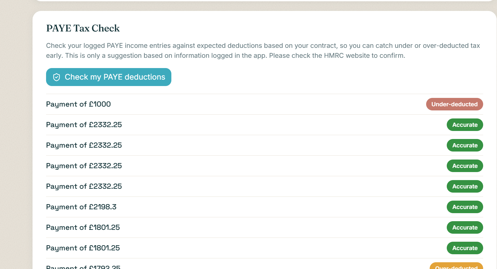
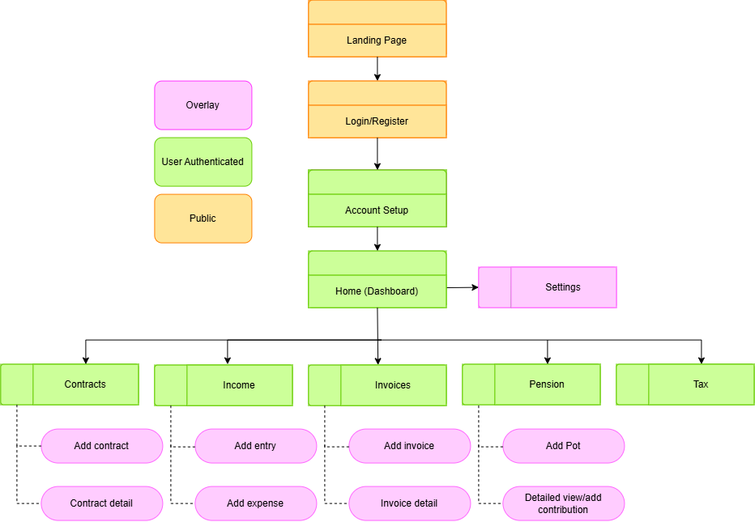
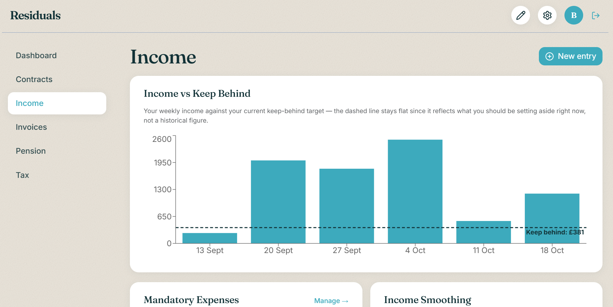
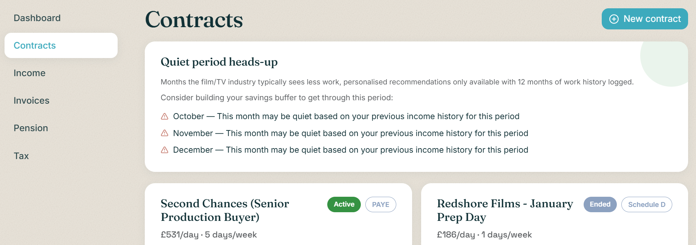
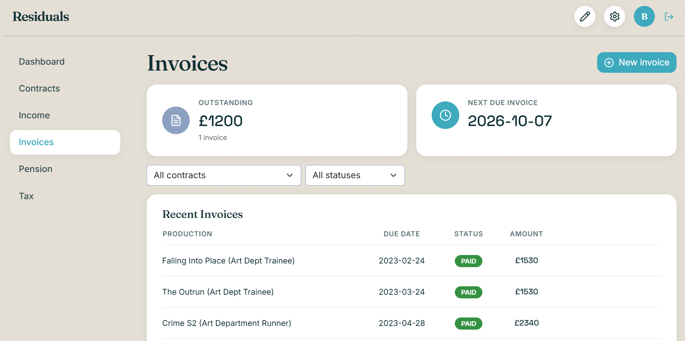
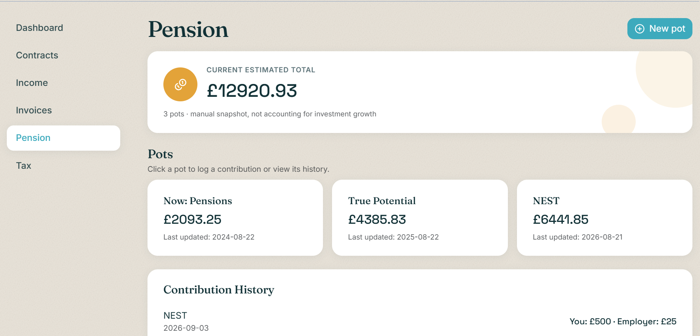
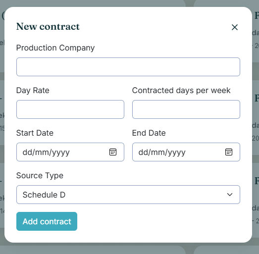

# Residuals

Financial planning for UK film and TV freelancers. Built as my MSc Software Development dissertation at the University of Glasgow (Distinction).

## The problem

Freelancers in film and TV have irregular income, a mix of PAYE and self-employed (Schedule D) work, multiple pension pots, and predictable quiet periods. Most budgeting apps assume a steady salary. Residuals helps freelancers plan around irregular work: how much to keep behind each week for tax and bills, how long their savings would last, and when quieter months are likely to hit.

## Features

- **Dashboard:** weekly keep-behind figure, savings runway and a smoothed suggested spend
- **Contracts and income:** log PAYE and Schedule D work, with day rates and contract dates
- **Income smoothing:** forecasts quiet months from the user's own history, falling back to industry-wide patterns when there's less than 12 months of data
- **Invoices:** draft, send and track invoices, with edits blocked once an invoice is sent
- **Pension consolidation:** track multiple pots and contributions in one place
- **Tax:** self-assessment estimate using Scottish and rUK tax bands, and a PAYE check that flags under- or over-deducted tax

## Tech stack

- **Backend:** Java, Spring Boot, Spring Security (JWT, BCrypt), Spring Data JPA, PostgreSQL
- **Frontend:** React, Vite
- **Testing:** JUnit, MockMvc
- **Process:** Agile, four weekly sprints, MoSCoW-prioritised backlog

## Architecture

A layered REST API (controllers, services, repositories) across twelve service classes, with request validation, centralised exception handling and per-user authorisation checks. UUID primary keys reduce the risk of insecure direct object references.

## Testing

- 17 MockMvc integration tests across invoicing, pensions, cash flow, income smoothing and PAYE tax checks, covering state transitions, error responses and threshold-based fallback logic
- Two rounds of usability testing with personas, scored with the System Usability Scale, with findings fed back into the design

## How I worked

I defined a 45-story backlog with acceptance criteria, prioritised with MoSCoW, and verified the 28 Must Have stories before the main build.

## More screenshots

## Code

The source code is kept private. I'm happy to walk through it or share access on request: becca.mcdonagh@hotmail.co.uk
